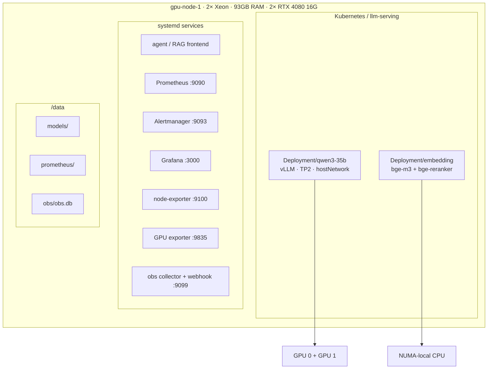
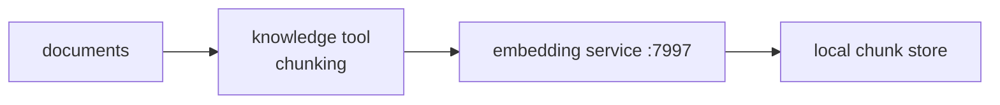
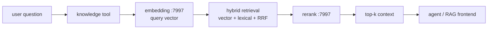
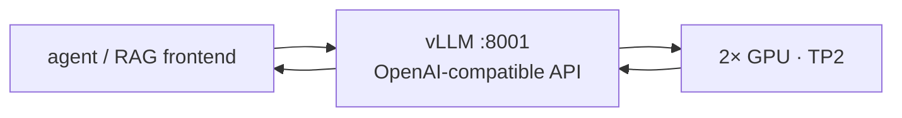
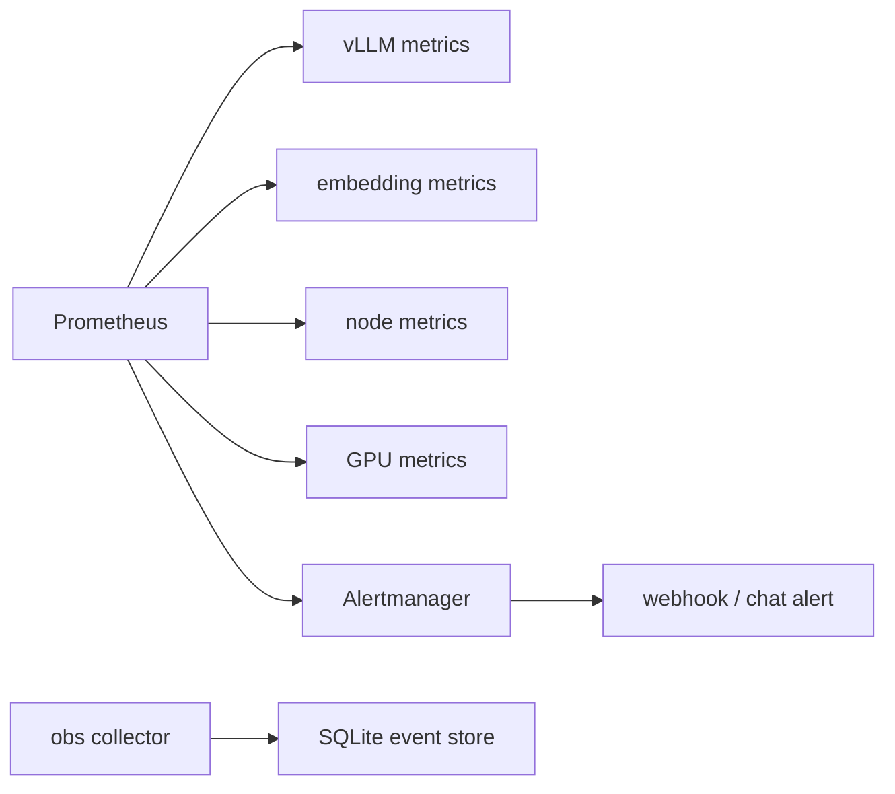

# 架构说明

> 这是一个脱敏后的参考架构。主机名、路径、端口均为示例，部署时按实际环境替换。

## 1. 部署视图

## 2. 请求流

### 2.1 入库流

### 2.2 查询流

### 2.3 生成流

### 2.4 可观测旁路

## 3. 关键约束

- **单节点单副本**：没有高可用，宿主机故障即平台中断。
- **GPU 独占**：vLLM 申请 2 张卡，TP2 权重分片；embedding 不占 GPU。
- **hostNetwork**：vLLM 直接使用宿主机端口 `8001`，因此必须显式设置 `dnsPolicy: ClusterFirstWithHostNet`。
- **NUMA 亲和**：embedding / rerank 是 CPU 推理，绑定到 GPU 所在 NUMA 节点，避免跨节点内存访问。
- **数据面分离**：模型、Prometheus TSDB、obs 事件库放在 `/data`，不跟系统盘混用。

## 4. 端口速查

| 组件 | 端口 | 说明 |
|---|---:|---|
| vLLM | 8001 | OpenAI 兼容 API |
| vLLM NodePort | 30080 | 集群外访问示例 |
| embedding / rerank | 7997 | infinity_emb |
| Prometheus | 9090 | 指标 |
| Alertmanager | 9093 | 告警路由 |
| Grafana | 3000 | 看板 |
| node-exporter | 9100 | 主机指标 |
| GPU exporter | 9835 | GPU 指标 |
| obs webhook | 9099 | 告警落库 |
